# VeinToVein — Blood Donation Network & Hospital Emergency Triage System

An end-to-end, medical-grade blood donation platform and hospital coordination network built for real-time emergency matching, empanelled hospital triage, verified donor passports, and regulatory compliance. Powered by a vanilla web frontend and a **Supabase (PostgreSQL)** cloud backend.

---

## 📌 Table of Contents
1. [Project Overview & Core Mission](#-project-overview--core-mission)
2. [Technology Stack](#-technology-stack)
3. [Empanelled Hospital Network](#-empanelled-hospital-network-bengaluru-hub)
4. [Key Architectural Modules](#-key-architectural-modules)
5. [Clinical & Safety Rules](#-clinical--safety-rules)
   - [ABO × RhD Blood Compatibility Matrix](#1-abo--rhd-red-cell-compatibility-matrix)
   - [NBTC 90-Day Mandatory Waiting Period](#2-nbtc-90-day-mandatory-cooling-period)
6. [Complete User & Admin Workflows](#-complete-user--admin-workflows)
   - [The Donor Journey](#the-donor-journey)
   - [The Hospital Administrator Journey](#the-hospital-administrator-journey)
7. [Repository File Map](#-repository-file-map)
8. [Supabase Backend Architecture & Database Schema](#-supabase-backend-architecture--database-schema)
9. [Getting Started & Local Execution](#-getting-started--local-execution)
10. [Regulatory & Data Compliance](#-regulatory--data-compliance)

---

## 🩸 Project Overview & Core Mission

In emergency trauma, surgical emergencies, and critical transfusions, every second counts. **VeinToVein** eliminates systemic delays by directly connecting verified, compatible donors with empanelled hospital blood banks.

The platform provides:
- **Instant Emergency Matching:** Filters incoming requisitions against verified donor blood groups using strict clinical transfusion rules.
- **Controlled Arrival Triage:** Real-time tracking of donors en route to blood banks, pre-screening verification, and digital receipting.
- **Automated Donor Record Sync:** Immediate updates to digital donor passports, verified donation count, lives impacted, and next eligibility dates.
- **Regulatory Cooling Locks:** Automated 90-day recovery interval enforcement under Indian National Blood Transfusion Council (NBTC) guidelines to ensure donor safety.

---

## 💻 Technology Stack

| Layer | Technologies Used | Description |
| :--- | :--- | :--- |
| **Frontend UI** | HTML5, Modern CSS3 | Custom typography (Fraunces serif, Inter, DM Sans), responsive layouts, dark & ivory luxury editorial theme. |
| **Interactive Canvas** | Three.js | Real-time 3D simulation of circulating red blood cells on the hero canvas. |
| **Client Logic** | Vanilla JavaScript (ES6+) | Standalone modules, reactive state management, capturing click interceptors, and local event buses. |
| **Backend & Database** | Supabase (PostgreSQL 15) | Managed relational database, Auth engine, Row Level Security (RLS), and automated PL/pgSQL triggers. |
| **Security & Privacy** | 256-Bit SSL, DPDP Act 2023 | Encrypted sessions, salted passwords, and compliance consent notices. |

---

## 🏥 Empanelled Hospital Network (Bengaluru Hub)

VeinToVein connects 6 premier healthcare facilities across the Bengaluru metropolitan region:

| No. | Hospital Name | Area / Location | Facility Type |
| :---: | :--- | :--- | :--- |
| **1** | **Apollo Hospitals** | Seshadripuram | Super-Speciality Blood Centre |
| **2** | **Fortis Hospital** | Cunningham Road, Vasanth Nagar | Emergency Cardiac & Trauma Bank |
| **3** | **Aster CMI Hospital** | Hebbal, Sahakara Nagar | Multi-Organ Transplant Blood Centre |
| **4** | **Manipal Hospitals** | Old Airport Road, Kodihalli | Tertiary Care & Apheresis Unit |
| **5** | **Narayana Health City** | Bommasandra | Cardiac & Oncology Transfusion Bank |
| **6** | **Manipal Hospitals Sarjapur Road** | Bellandur, Sarjapur Road | Critical Care & Trauma Unit |

---

## 🏗 Key Architectural Modules

### 1. Public Portal & Live Emergency Feed (`index.html`)
- **Real-Time Emergency Feed:** Live cards showing hospital requisitions, urgency level (Critical, Urgent, Stable), blood group needed, patient notes, and fulfillment progress.
- **Smart Pacing Throttler:** Built-in timer interceptor paces automated simulated requisitions to 1–2 minutes, ensuring a realistic broadcast flow.
- **Live ABO × RhD Compatibility Checker:** Interactive matrix allowing visitors to select any blood type and view red cell donation and reception rules.
- **Eligibility Pre-Screening:** Fast questionnaire verifying age ($\ge 18$), weight ($\ge 45\text{ kg}$), and travel/medical history.
- **Push Notification Panel:** Dropdown bell notification center alerting users to critical emergencies.

### 2. Donor Authentication Gateway (`auth.html`)
- **Sign In & Register Tabbed Interface:** Clean, focused interface for donor credentials and profile creation.
- **Full Donor Intake Form:** Collects full name, email, password, phone number, blood group, city, and optional previous donation date.
- **Show/Hide Password Toggle:** Eye icon toggle for password visibility.
- **Active Session Detection:** Automatically detects active Supabase sessions and displays the logged-in profile card with a direct link to the dashboard.
- **Clear Error Diagnostics:** Friendly error handling for invalid credentials, unconfirmed emails, or rate limits.

### 3. Verified Donor Passport (`profile.html` & `profile.js`)
- **Digital Donor ID Card:** Visual credential styled with golden microchip, QR placeholder, donor ID (`VT-IN-YYYY-XXXXX`), blood type, and KYC badge.
- **Live Impact Analytics:** Dynamic counters for **Donations Facilitated**, **Lives Impacted** (calculated at $3\text{ lives}/\text{donation}$), and **Impact Points** with tier status.
- **NBTC Passport Chip:** Reactive badge showing either `ELIGIBILITY PASSPORT ACTIVE · ELIGIBLE NOW` or `🔒 90-DAY COOLING PERIOD ACTIVE · NEXT [DATE]`.
- **Donation History Ledger:** Table displaying past donation logs (Date, Hospital Centre, Component, Hemoglobin level, Status, Certificate Download).

### 4. Hospital & Blood Bank Administration Dashboard (`admin.html` & `admin.js`)
- **Multi-Hospital Switcher:** Filter view between all 6 centres or focus exclusively on a single facility.
- **Live Donor Arrivals & Check-In Desk:**
  - Real-time queue of donors who clicked "I Can Donate" on the emergency feed.
  - Displays Donor Name, Blood Group, Phone, Departure timestamp, ETA, and Target Hospital.
  - **`Mark Arrived`** action transitions donor from `En Route` to `At Desk · Pre-Screening`.
  - **`Verify & Complete Donation`** action opens clinical intake modal to confirm vitals (Hemoglobin $\ge 12.5\text{ g/dL}$, volume: 350ml / 450ml).
- **Automated Profile Sync:** Completing a donation updates the donor's record in Supabase, increments their counters, and activates the 90-day waiting period lock.
- **Emergency Broadcast Center:** Allows hospital administrators to dispatch new emergency blood requisitions directly to the public live feed.
- **Cold-Chain Inventory Meters:** Real-time stock counters for all 8 blood groups per hospital with quick adjustment buttons.
- **Registered Donor Registry:** Searchable table of all registered donors with their cooling period status.
- **Simulate Test Arrival:** Single-click simulation button for instant testing of the entire arrival and completion workflow.

### 5. Backend Client & Business Logic (`supabase.js`)
- Initializes the Supabase client with project credentials.
- Houses authentication methods: `signUpDonor`, `signInDonor`, `signOutDonor`, and `getCurrentDonor`.
- Enforces blood compatibility and legal cooling period locks on `.accept-btn`.
- Intercepts donation acceptance to create hospital dispatch tickets.
- Keeps `localStorage` and Supabase tables synchronized across browser tabs.

---

## 🔬 Clinical & Safety Rules

### 1. ABO × RhD Red Cell Compatibility Matrix
The system enforces strict red blood cell transfusion rules. Incompatible donors are prevented from accepting emergency requests:

| Donor Blood Group | Compatible Recipients (Can Donate To) | Clinical Notes |
| :---: | :--- | :--- |
| **O−** | **O−, O+, A−, A+, B−, B+, AB−, AB+** | **Universal Red Cell Donor** |
| **O+** | O+, A+, B+, AB+ | Compatible with all positive groups |
| **A−** | A−, A+, AB−, AB+ | Negative Rh compatible with A and AB |
| **A+** | A+, AB+ | Positive Rh compatible with A+ and AB+ |
| **B−** | B−, B+, AB−, AB+ | Negative Rh compatible with B and AB |
| **B+** | B+, AB+ | Positive Rh compatible with B+ and AB+ |
| **AB−** | AB−, AB+ | Universal Plasma donor; red cells to AB |
| **AB+** | **AB+ only** | **Universal Recipient** |

### 2. NBTC 90-Day Mandatory Cooling Period
In accordance with the **National Blood Transfusion Council (NBTC)** and Indian regulatory guidelines:
- Whole blood donation requires a minimum interval of **90 days (12 weeks)** for male/general donors to allow complete hemoglobin restoration and iron store replenishment.
- **System Enforcement:**
  - Upon donation completion, `last_donation` is set to today's date.
  - If $\text{Days Since Last Donation} < 90$, the donor is flagged as **Ineligible / Resting**.
  - On [index.html](file:///e:/PROJECT/New%20folder/index.html), the accept button displays `🔒 Cooling Period (90d left)` and prevents click-through.
  - Clicking the locked button provides an educational prompt indicating the exact next eligible date.
  - On [profile.html](file:///e:/PROJECT/New%20folder/profile.html), the passport chip turns amber/red and displays the remaining days countdown.

---

## 🔄 Complete User & Admin Workflows

### The Donor Journey
```mermaid
flowchart TD
    A[Visitor opens Homepage] --> B{Authenticated?}
    B -- No --> C[Browse Live Feed in Guest Mode]
    C --> D[Click 'Sign In to Donate' -> Redirect to auth.html]
    B -- Yes --> E[Live Feed checks Blood Group & Last Donation Date]
    E --> F{Cooling Period < 90 Days?}
    F -- Yes --> G[Button Locked: 'Cooling Period Active' with Countdown]
    F -- No --> H{ABO/Rh Blood Compatible?}
    H -- No --> I[Button Locked: 'Incompatible Type Mismatch']
    H -- Yes --> J[Button Active: 'I Can Donate (Type)']
    J --> K[Donor Clicks Accept]
    K --> L[Dispatch Ticket Created VT-ARR-XXXX]
    L --> M[Card updates to 'En Route to Hospital']
    M --> N[Hospital Admin Desk alerted of incoming donor]
```

### The Hospital Administrator Journey

```mermaid
flowchart LR
    A1[Admin opens admin.html] --> B1[Selects Hospital Centre]
    B1 --> C1[Views Inbound Donors En Route]
    C1 --> D1[Donor physically arrives at centre]
    D1 --> E1[Admin clicks 'Mark Arrived' -> Status: Pre-Screening]
    E1 --> F1[Admin clicks 'Verify & Complete Donation']
    F1 --> G1[Enters Hb vitals & confirms collection]
    G1 --> H1[System sets last_donation = today]
    H1 --> I1[Increments Donor Profile: +1 Donation, +3 Lives]
    I1 --> J1[Activates 90-Day Waiting Period Lock]
    J1 --> K1[Increments Hospital Blood Stock Inventory]
```


---

## 📁 Repository File Map

```
e:\PROJECT\New folder\
│
├── index.html            # Public homepage, live feed, compatibility matrix, Bangalore hospitals
├── auth.html             # Secure Sign In & Registration portal with Supabase Auth
├── profile.html          # Verified donor passport, digital ID card, live stats & history
├── admin.html            # Multi-hospital admin control desk, arrivals triage, inventory meters
│
├── script.js             # Homepage animations, Three.js 3D red blood cell canvas, UI counters
├── profile.js            # Profile dashboard logic, dynamic Supabase sync, donation history ledger
├── admin.js              # Hospital admin logic, arrival check-in, donation finalizer, compliance
├── supabase.js           # Supabase client, auth handlers, ABO compatibility engine, NBTC rules
│
├── style.css             # Unified design system: Fraunces & Inter fonts, dark/ivory/crimson theme
├── supabase_schema.sql   # PostgreSQL DDL schema: profiles, blood_requests, donations tables & RLS
└── README.md             # Complete technical & functional documentation
```

---

## 🗄 Supabase Backend Architecture & Database Schema

### Supabase Connection Parameters
- **Project ID:** `mabpdkcknwimeetyixjj`
- **Supabase URL:** `https://mabpdkcknwimeetyixjj.supabase.co`
- **Publishable / Anon API Key:** `sb_publishable_C1LHXBEyBTAtTqC9XebhOA_nQtfvvit`

### Relational Schema Summary

#### 1. `public.profiles`
Stores verified donor passport data linked to Supabase Auth UUIDs.
- `id` (`uuid`, Primary Key, references `auth.users.id` on delete cascade)
- `email` (`text`)
- `full_name` (`text`)
- `phone` (`text`)
- `blood_group` (`text`, e.g. `'AB+'`, `'O-'`)
- `city` (`text`)
- `last_donation` (`date`)
- `donor_id` (`text`, unique, e.g. `'VT-IN-2026-04817'`)
- `donations_count` (`integer`, default `0`)
- `lives_impacted` (`integer`, default `0`)
- `impact_points` (`integer`, default `0`)
- `tier` (`text`, default `'Silver'`)
- `kyc_verified` (`boolean`, default `true`)
- `created_at` / `updated_at` (`timestamptz`)

#### 2. `public.blood_requests`
Stores hospital emergency requisition broadcasts.
- `id` (`uuid`, Primary Key)
- `req_code` (`text`, unique, e.g. `'REQ-101'`)
- `hospital_name` (`text`)
- `blood_group` (`text`)
- `urgency` (`text`: `'Critical'`, `'Urgent'`, `'Stable'`)
- `units_required` (`integer`)
- `ward` (`text`)
- `clinical_notes` (`text`)
- `status` (`text`: `'Seeking Donors'`, `'Fulfilled'`)
- `created_at` (`timestamptz`)

#### 3. `public.donations`
Stores completed donation transaction logs and certificate codes.
- `id` (`uuid`, Primary Key)
- `donor_id` (`text`)
- `donor_email` (`text`)
- `donor_name` (`text`)
- `blood_group` (`text`)
- `hospital_name` (`text`)
- `component` (`text`, e.g. `'Whole Blood · 350 ml'`)
- `hemoglobin` (`numeric`, e.g. `14.2`)
- `cert_code` (`text`, unique, e.g. `'VT-CERT-2026-8910'`)
- `donation_date` (`date`)
- `created_at` (`timestamptz`)

#### 4. Automated User Onboarding Trigger (`handle_new_user`)
A PostgreSQL trigger function executes automatically on `auth.users` insertion, populating `public.profiles` with registration metadata instantly.

---

## 🚀 Getting Started & Local Execution

### 1. Running the Platform
No compilation or build step is required. The platform runs on standard HTML5, CSS3, and modern JavaScript:
- **Option A (Direct):** Double-click `index.html` to open in Google Chrome, Microsoft Edge, Firefox, or Safari.
- **Option B (VS Code Live Server):** Right-click `index.html` and select **"Open with Live Server"**.
- **Option C (Python local server):**
  ```bash
  cd "e:\PROJECT\New folder"
  python -m http.server 8000
  ```
  Open `http://localhost:8000` in your web browser.

### 2. Testing Credentials & Workflows
- **Sign In / Registration:** Open `auth.html`.
- **Admin Control Desk:** Open `admin.html` or click **"Admin Desk ↗"** from any navigation bar.
- **Instant Test:** In `admin.html`, click **"Test Donor Arrival"** to generate a test arrival ticket, verify it, mark it completed, and watch the donor's 90-day waiting period lock take effect!

---

## 🛡 Regulatory & Data Compliance

1. **NBTC Clinical Guidelines:** Enforces mandatory 90-day whole blood recovery periods for donor safety.
2. **DPDP Act 2023 (Digital Personal Data Protection):** User registration mandates explicit affirmative consent for blood group and emergency contact storage.
3. **Row Level Security (RLS):** Supabase database policies restrict write operations to authorized records while allowing verified emergency requisition reads.
4. **Data Isolation:** All administrative inventory adjustments and donor arrival states maintain resilient client-side fallbacks with automated cloud synchronization.

---

*© 2026 VeinToVein Blood Network · Section-8 Registered Nonprofit Healthcare Initiative*
